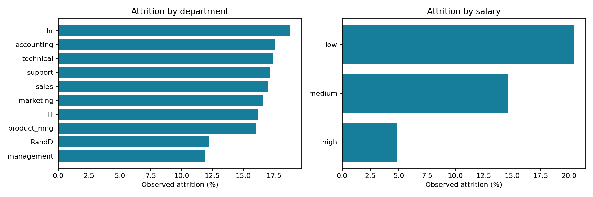
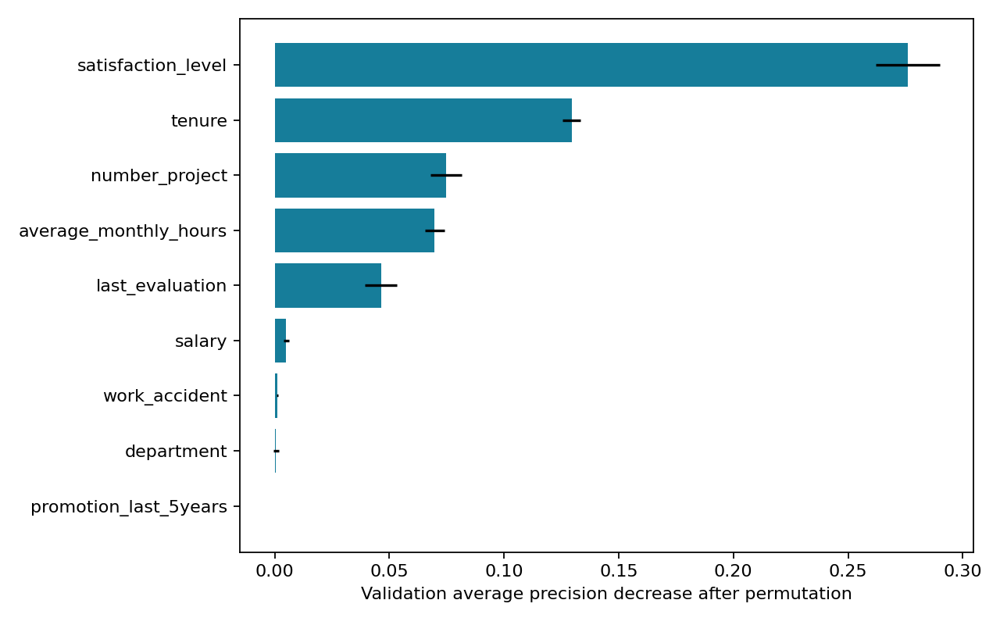

# Salifort Motors — Employee Attrition

**Understanding employee turnover through reproducible analytics and machine learning.**

[Explore the notebook](notebooks/Salifort_Motors_Complete.ipynb) · [Read the executive report](reports/executive_report.md) · [Download the presentation](reports/executive_presentation.pptx) · [Model card](docs/MODEL_CARD.md)

A complete PACE (Plan, Analyze, Construct, Execute) case study covering data quality, exploratory analysis, model comparison, and practical retention recommendations. Built with Python, pandas, scikit-learn, and Matplotlib.



## Business objective

Help HR leaders understand which recorded employee characteristics are associated with departure and assess whether a classifier can distinguish leavers in a held-out sample. Translate the findings into measurable, supportive retention initiatives.

**Scope:** a retrospective portfolio case study using the supplied dataset. The analysis does not establish causal effects or readiness for individual employment decisions.

## Main findings

- 14,999 raw rows; 3,008 exact duplicates; 11,991 deduplicated rows; no missing cells.
- Attrition is 23.8% in the raw data and 16.6% after deduplication. Confirm the duplicate-removal assumption because no employee IDs are supplied.
- The random forest selected on validation average precision achieves held-out precision of 98.1%, recall of 91.5%, F1 of 0.947, and average precision of 0.964.
- At threshold 0.5: 364 leavers identified, 34 missed, and 7 stayers incorrectly flagged among 2,399 test records.
- These retrospective results support further investigation, not causal conclusions or immediate operational deployment.

## Results at a glance

| Held-out metric | Random forest |
| --- | ---: |
| Precision | 98.11% |
| Recall | 91.46% |
| F1 score | 0.947 |
| ROC AUC | 0.980 |
| Average precision | 0.964 |
| Test records | 2,399 |

The model was selected using **validation average precision**, then refitted on development data and evaluated on the held-out test set at a fixed threshold of 0.5.



## Deliverables

| Deliverable | Description |
| --- | --- |
| [Completed notebook](notebooks/Salifort_Motors_Complete.ipynb) | Executed PACE analysis with commentary, tables, and visualizations |
| [Executive report](reports/executive_report.md) · [Word version](reports/executive_report.docx) | Business findings, methodology, recommendations, and limitations |
| [Executive presentation](reports/executive_presentation.pptx) | Ten-slide presentation for stakeholders |
| [Validation comparison](reports/validation_metrics.csv) | Candidate model performance used for selection |
| [Held-out results](reports/model_results.json) | Final metrics, confusion matrix, and bootstrap interval |
| [Data dictionary](docs/DATA_DICTIONARY.md) | Column meanings, types, and interpretation caveats |
| [Model card](docs/MODEL_CARD.md) | Intended use, evaluation design, and model limitations |
| [Original notebook](notebooks/PACE_original.ipynb) | Uploaded source preserved unchanged |

## Repository structure

```text
data/           Supplied HR dataset
notebooks/      Original and completed, executed notebooks
src/            Reproducible analysis, document generation, notebook execution
reports/        Executive documents, metrics, group tables, and figures
docs/           Data dictionary and model card
requirements.txt  Pinned direct dependencies
```

## Reproduce

Python 3.12 was used. From the repository root:

```bash
python3 -m venv .venv
.venv/bin/python -m pip install -r requirements.txt
export MPLCONFIGDIR=/tmp/salifort-mpl
export XDG_CACHE_HOME=/tmp/salifort-cache
.venv/bin/python src/analysis.py
.venv/bin/python src/build_deliverables.py
```

To execute all five code cells of the completed notebook and regenerate its saved outputs:

```bash
.venv/bin/python src/execute_notebook.py
```

The notebook invokes the same analysis module, and rerunning it regenerates the metrics, figures, report, and presentation. The original notebook is an archival input; its unused XGBoost import is not a dependency of the completed workflow. No web server, external API, credentials, or paid services are required.

## Method

Remove exact duplicates before splitting, rename inconsistent columns, and retain tenure extremes. Use a stratified 60/20/20 split with seed 42. Fit imputation, scaling, and one-hot encoding within training pipelines. Compare dummy, logistic, decision-tree, and random-forest classifiers; select on validation average precision. Refit the selected pipeline on development data, then evaluate the held-out test set once at a fixed 0.5 threshold. Compute permutation importance on validation before refitting. A 500-resample test-prediction bootstrap provides a conditional average-precision interval.

The dummy model's high accuracy illustrates why accuracy alone is unsuitable: it misses every leaver at the fixed threshold. See the validation table for all model scores.

## Recommendations and limits

Investigate workload and project allocation, gather confidential feedback, and pilot voluntary retention support with measurable outcomes. Confirm data provenance, duplicate handling, feature timing, and permission to redistribute. There are no employee identifiers, timestamps, authoritative data dictionary, or license in the supplied ZIP. Random record splits cannot establish future-cohort performance; similar profiles may remain across splits. No causal effect, fairness assessment, calibrated probability, or financial benefit has been established. Prospective validation and appropriate governance are prerequisites for operational use.

## Data source and attribution

Inputs were supplied by the user in `Salifort Motors.zip`; provenance beyond that is unverified. The spelling “Sailfort-Motors” is retained for the repository path; “Salifort Motors” follows the supplied project files. The original notebook and CSV are retained unchanged for traceability. No license or original-data authorship is claimed for the supplied materials. See the [data dictionary](docs/DATA_DICTIONARY.md) for provenance limits.
